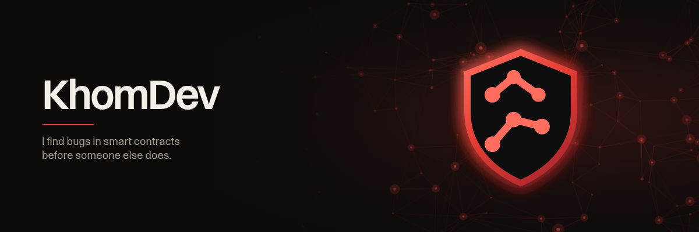

<!--
  DRAFT for KhomDev/KhomDev profile README.
  Not committed. Not pushed. Review before anything goes to GitHub.
-->

<div align="center">

<!--
  Hero banner (option 2, approved): custom still, 1200×400.
  Source: assets/banner.svg (Switzer embedded). Also assets/banner@2x.png.
  Built programmatically (SVG → PNG via headless Chrome). Not committed yet.
-->


# KhomDev

**I find bugs in smart contracts before someone else does.**

Yuriy Khomenkov · independent smart contract security researcher  
Available for private audits · every finding proven on the real contracts

[khomdev.org](https://khomdev.org) ·
[X @YKhomenkov](https://x.com/YKhomenkov) ·
[HackenProof](https://hackenproof.com/hackers/KhomDev) ·
[CV](https://khomdev.org/cv/)

<br />

[](https://hackenproof.com/hackers/KhomDev)
[](https://khomdev.org/#dataset)
[](https://khomdev.org/research/)

</div>

---

## Featured work

Audit tools first, then the Vyper and NEAR work. All links below are public and verified.

| Project | What it is | Links |
| --- | --- | --- |
| **[realism-gate](https://github.com/KhomDev/realism-gate)** | Does the proof prove the claim? A Rust CLI that reads Foundry, Solana and Move PoCs and binds each report claim to `SHOWN`, `NOT SHOWN`, `CONTRADICTED`, or `NOT CHECKABLE`. v1.4.0. | [GitHub](https://github.com/KhomDev/realism-gate) · [crates.io](https://crates.io/crates/realism-gate) |
| **[priorart](https://github.com/KhomDev/priorart)** | Is it new, in scope, and payable? Offline dossiers from the program files you already saved — known issues, prior audits, exclusion clauses, payout tiers. Retrieval only: it never says “duplicate”. v0.2.2. The 113-rejection dataset lives here. | [GitHub](https://github.com/KhomDev/priorart) · [crates.io](https://crates.io/crates/priorart) |
| **[vyper-scales](https://github.com/KhomDev/vyper-scales)** | Open evidence tooling for Vyper: cross-contract seam coverage (`seamcheck`), compiler semantic diffs, and a signature compatibility matrix. Unparsed `extcall` / `raw_call` is `UNASSESSED`, not a silent skip. | [GitHub](https://github.com/KhomDev/vyper-scales) |
| **[TriagePay](https://github.com/KhomDev/TriagePay)** | A policy wallet on NEAR for AI agents that pay per call (x402). The agent signs; the contract decides. Prompt-injected payees are refused on chain. | [GitHub](https://github.com/KhomDev/TriagePay) · [demo](https://triagepay-demo.vercel.app) |
| **[Vibe Wallet](https://github.com/KhomDev/vibe-wallet)** | Talk to your NEAR wallet. Voice or text becomes a proposed transaction, limits in code check it, and nothing is signed until you confirm. Live on mainnet. | [GitHub](https://github.com/KhomDev/vibe-wallet) · [app](https://vibe-wallet-flame.vercel.app) |

```text
cargo install priorart --locked && priorart check finding.md
cargo install realism-gate --locked && realism-gate check test/ --report finding.md
```

Also public: the four Flywheel Vyper protocols on GitLab — [tare](https://gitlab.com/khomdev-group/tare), [keep](https://gitlab.com/khomdev-group/keep), [coil](https://gitlab.com/khomdev-group/coil), [veforge](https://gitlab.com/khomdev-group/veforge) — and [vyper-upgrade-receipt](https://github.com/KhomDev/vyper-upgrade-receipt).

---

## Record

The numbers on [khomdev.org](https://khomdev.org), 27 Nov 2026:

- **20 paid findings** across 50 programs — **3 High**, 17 Low — every one accepted by the team that owned the code
- **HackenProof** leaderboard **#215**, 597 reputation
- **113 rejected reports**, logged in the open — **55.8%** could have been stopped from the public record
- Public credit from [Ledgity Yield](https://khomdev.org/record/ledgity-migration-boundary/) for a private yield-accounting disclosure

I pin scope to a commit, try to break the invariants the protocol depends on, and report only what I've proven with a test against the real contracts.

---

## Stack

<p align="center">
  
  
  
  
  
  
  <br />
  
  
  
  
  
</p>

<div align="center">
  
  
</div>

---

## Elsewhere

- Site — [khomdev.org](https://khomdev.org)
- Writing — [khomdev.org/research](https://khomdev.org/research/) · [Paragraph](https://paragraph.com/@yuriykhomenkov@gmail.com)
- X — [@YKhomenkov](https://x.com/YKhomenkov)
- Email — [yuriykhomenkov@gmail.com](mailto:yuriykhomenkov@gmail.com)

If you are a researcher: the data is free, and both tools run offline with no account.  
If you are a team: I am available for scoped review, and I will tell you what I could not break.
